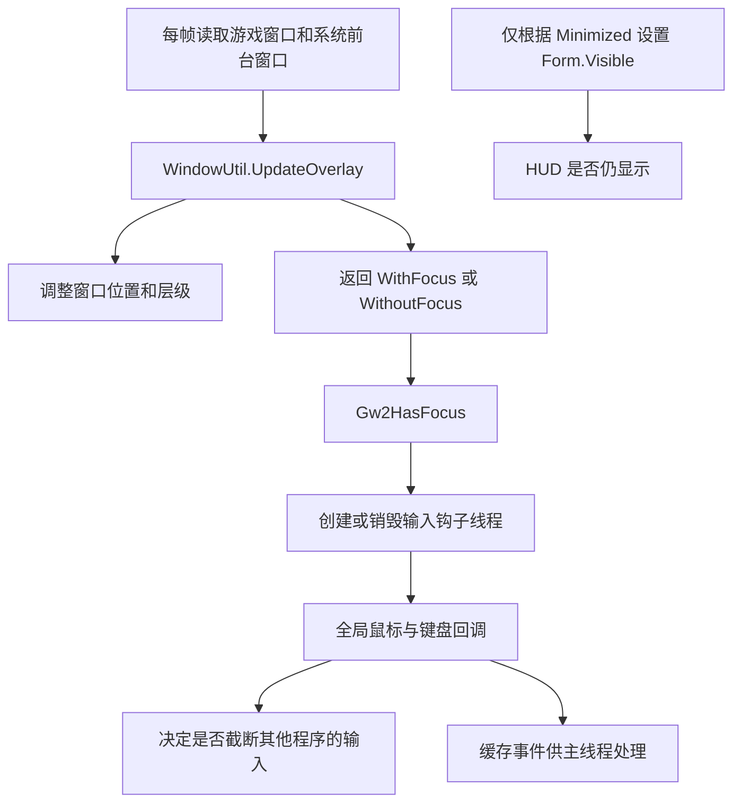

# EzBlish 窗口显示、输入恢复与 Overlay 共存方案

## 结论

当前问题需要同时调整窗口状态和输入生命周期。只增加置顶次数，不能解决 `/wiki` 打开浏览器后 HUD 覆盖网页、回到游戏后交互异常的问题，也可能增加与其他 overlay 的层级竞争。

本分支没有重写原版的窗口和输入系统。焦点识别、后台显示策略、鼠标及键盘钩子、失焦清理基本沿用上游。直接相关的本地改动集中在 `WindowUtil.cs`：增加每秒一次的层级丢失检查，并为窗口调整添加 `SWP_NOACTIVATE`。后者应保留；层级恢复的目标应从“重新放到 TOPMOST”改为“回到游戏上方，同时尊重其他窗口”。

源代码可以确认失焦清理不完整、鼠标离散事件会互相覆盖、切换焦点反复重装全局钩子等问题。但现有信息不能证明 `/wiki` 的两个连续现象一定来自同一个缺陷，也不能确定未具名的第三方 overlay 是被遮挡、输入被截断，还是自身发生了图形问题。

建议保留现有独立透明窗口、MonoGame 渲染及模块体系，分两批完成同一套设计：先完成确定的窗口状态转换和输入复位；再完成稳定的钩子生命周期、完整事件传递和有限的跨窗口输入让行。无需新增依赖、兼容模式或另一套渲染后端。

## 对照基线

资料核对截至 2026 年 9 月 14 日，结论适用于以下源码版本。正在实际使用的可执行文件及其设置尚未与该基线核对，因此源码结论与现场根因分开表述。

| 对象 | 基线 | 用途 |
| --- | --- | --- |
| EzBlish 本地分支 | `feat/paged-cjk-font-atlas`，`d133dfb`，程序集版本 1.4.2.0 | 当前方案的修改对象 |
| 上游当前开发分支 | `3f15903a06b8fa24ca3a0cfdd2af3fb5b23b9e01`，2026-02-19 | 已核对远端 `dev` 指向，用于逐文件差异比较 |
| 上游最新正式版 | v1.3.0，`8aa65ba`，2026-01-03 发布 | 正式版行为对照；发行说明包含切回游戏的点击改进 |
| 现有框架 | .NET Framework 4.7.2、WinForms、MonoGame WindowsDX 3.8.0.1641 | 方案不依赖框架升级 |
| 同类实现参考 | GW2TacO，`70871b99f0d535805de977c7624a6307080c54ff` | 参考相对游戏的层级管理与文本编辑焦点分离 |

上游正式版与开发版之间，相关鼠标文件还有滚轮和滚动后的命中更新；本分支已包含这些改进。不能把“尚未合入原版切回点击修复”当成本次答案。[1][2][3]

## 与原版的实际差异

| 行为 | 原版 | 当前 EzBlish | 判断 |
| --- | --- | --- | --- |
| 窗口形态 | 独立透明、分层窗口，全窗口原生鼠标穿透 | 相同 | 没有架构层面的不同 |
| 游戏失焦 | 尝试把 HUD 放到游戏前一窗口之后，不因失焦直接隐藏 | 相同 | 网页串层风险的策略基础沿自原版 |
| 游戏最小化 | 根据窗口坐标推断并隐藏 Form | 相同 | 与普通失焦不是同一条路径 |
| 前台判断 | 游戏 HWND 在前台，或者本进程存在前台 WinForms Form，即返回 `WithFocus` | 相同 | “游戏前台”和“本应用原生窗口前台”混在一起 |
| 回到游戏或改变尺寸 | `SetWindowPos(..., HWND_TOPMOST, ..., 0)` | 增加 `SWP_NOACTIVATE` | 本地改进正确，降低自动激活窗口的副作用 |
| HUD 落到游戏后面 | 没有当前这段周期恢复 | 最多每秒检查一次；确认在游戏下方才调用 TOPMOST | 确实能修复一类丢层；恢复目标仍过强 |
| 输入钩子 | 获得焦点创建线程、安装；失去焦点卸载、等待线程退出 | 相同 | 原版的生命周期耦合保留至今 |
| 鼠标事件传递 | 单个 `_mouseEvent` 字段 | 相同 | 原版缺陷仍存在 |
| 失焦清理 | 键盘清掉部分按键状态；鼠标仅修改 `_recentlyEnabled` | 相同 | 没有完整取消交互 |
| 更高帧率 | 原有帧率档位 | 增加 120/144/165/240 档位 | 属于图形设置差异，无证据将它认定为本次根因 |

相关历史中，`db17cac` 的第一版层级修复已经被 `30a0df8` 撤销；现行代码是 `201eaa3`。现行代码不是每秒无条件抢最上层：只要 HUD 已在游戏之上，`HasLostZOrder` 就返回 false。这个区别很重要，不能把已经撤销的行为当作现状。[2][4]

## 当前链路为什么容易失配

这套链路没有统一回答三个不同的问题：游戏是否真正处于系统前台、HUD 是否应当显示、某一次输入是否确实属于 HUD。结果可以是 HUD 还在画面上但钩子已关闭，也可以是本进程原生对话框在前台但全局 HUD 输入仍被启用。[5][6]

### 浏览器上的 HUD：显示策略有明确缺口，现场路径尚需定位

`WindowUtil.cs:203–212` 在失焦时只处理一次相对层级；`Gw2InstanceIntegration.cs:397–398` 仅根据最小化状态控制可见性。普通切换到浏览器不会主动隐藏 HUD，也没有后台持续维护相对层级的策略。

这本来是原版的一种产品选择：即使游戏在后台，仍可看到覆盖在游戏上的 HUD。它是否遮住浏览器，取决于当时的真实层级以及随后的窗口变化；不能仅凭源码断言每次 `/wiki` 都会遮住浏览器。可以确定的是，实现没有保证“离开游戏即撤走游戏 HUD”，也不能保证一次调整后其他程序不会再次改变层级。[2][5]

Windows 的 TOPMOST 属性不会因为窗口失去激活而自动消失，`SWP_NOACTIVATE` 只约束这一次窗口操作是否激活。因此补上该参数并不能替代显式的后台显示策略。[7]

**建议直接改变产品行为：浏览器或其他应用成为前台时，隐藏游戏 HUD；游戏重新成为前台时，无激活地恢复。** 这会同时取消“游戏留在另一块屏幕后台时仍显示 HUD”的原版行为，属于应当明确写入变更说明的取舍，不再额外保留后台显示模式。

### 切回游戏点不了：已确认的缺陷与候选原因

| 项目 | 代码证据和可达过程 | 能解释什么 | 证据边界 |
| --- | --- | --- | --- |
| 相机拖拽状态跨失焦残留 | 游戏内按住右键转视角，切出去后松开；钩子停用期间收不到释放，`OnDisable` 不清 `CameraDragging`；切回来 `Update` 仍提前返回 | HUD 不再正常处理鼠标；游戏可能仍可操作 | 确定缺陷，但没有证据表明本次 `/wiki` 前发生过右键拖拽；再次收到右键释放也可能恢复，不一定非重启不可 |
| 首次命中没有重建 | 失焦帧只将 `_hudFocused` 置 false；恢复后只在鼠标坐标变化时更新 `ActiveControl` | 原位置点击穿到游戏、悬停和拦截判定不一致 | 确定缺口，不能单独解释持续完全无响应 |
| 原生 Form 的坐标判断错误 | `ClientRectangle` 是客户区坐标，却直接与 hook 的屏幕坐标比较；代码明确支持 Debug、Pathing 编辑器等 Form | 对话框移到非原点位置后，错误决定是否让行鼠标 | 确定缺陷，主要影响本进程原生窗口 |
| 其他软件阻止输入或改变光标状态 | 主程序依赖 hook 事件；`CursorIsVisible == false` 时不处理 HUD 鼠标 | 界面仍可见，但鼠标交互消失 | 上游确认了新版 YoloMouse 的不兼容现象；具体技术路径和本机是否使用它未确认 |
| 钩子安装失败或被系统移除 | 安装错误只有日志；启用依赖下一次焦点边沿；Windows 可静默移除超时 hook | 主界面仍显示，但没有正常输入回调 | 机制成立，当前没有错误日志或耗时证据证明此次发生 |

鼠标缺陷见 `MouseHandler.cs:73–100、128–171、235–242`；原生 Form 坐标问题在 79–83 行。上游 2026-08-06 发布的排障说明明确指出新版 YoloMouse 会导致无法与 Blish HUD UI 交互，但没有给出精确受影响版本号，不能扩展成“所有版本都冲突”。[8][9][10]

### 鼠标事件不是完整的序列

非移动鼠标事件被写入唯一的 `_mouseEvent`。如果两次离散事件发生在一次主线程更新之间，后一个直接覆盖前一个。按下和释放、连续滚轮事件都可能丢失；在受支持的低帧率设置或模块更新变慢时即可出现，不需要构造特殊输入。

控件点击依赖先收到按下：`Control.OnLeftMouseButtonPressed` 设置 `_clickPrimed`，释放时才触发 Click。`SimulateNonCapturePressedEvent` 只为刚启用后的特定首个释放补按下，无法修复一般的事件覆盖。另外，分发事件时使用的是更新时的 `MouseState`，没有按照每个事件自己的坐标和按钮转换重建状态。[8][11]

因此，修复应是保留事件顺序及其发生位置，而不是增加更多“漏了就补一个点击”的特殊路径。该缺陷可以造成漏点击和滚动丢失，但仍不能直接等同于 `/wiki` 后的永久失效。

### 键盘失焦清理也不完整

`KeyboardHandler.OnDisable` 会清除 `_keysDown` 并发出内部 KeyUp，这是正确的；但未清空 `_inputBuffer`，也未撤销 `FocusedControl` 和文本输入监听。若焦点切换时已有待处理事件，之后的 `Update` 仍可能消费它们；返回游戏后，旧文本控件也可能继续接收输入。取消文本编辑还应停止选择拖动和按键重复，不能只清键码集合。[12]

应保留当前精确比较修饰键的逻辑。历史 issue #862 提到的 `Alt+T` 误匹配 `Alt+Shift+T`，其旧式包含判断已经被替换；不应把该旧 issue 当作当前仍未修复的直接证据。后续需要改进的是让钩子的阻断判定与当次键盘状态一致，而非重新实现已经存在的精确匹配。[13]

## 其他 overlay 冲突应如何归因

### 窗口层级竞争

多个独立 HWND overlay 都可以调整自身层级。现行 EzBlish 在重新获得焦点、尺寸变化或检测到自己落在游戏后面时，会使用 TOPMOST。这个操作的目标比“在游戏之上”更强，可能改变与其他顶层 overlay 的相对顺序。它能够解释遮挡、消失感或不同启动顺序下的显示差异，不能证明其他进程崩溃或卡死。[2][7]

GW2TacO 的实际实现会参考游戏的前一个窗口，将自己放在游戏附近；同时把文本框编辑所需的焦点处理单列。这个“相对游戏定位、区分输入场景”的分工值得采用。但 TacO 也存在主动 `SetForegroundWindow` 的路径，不能把整段实现照搬成无争抢方案。[14]

### 输入钩子竞争

现有代码只有在事件被判断为已处理时才返回 1，否则调用 `CallNextHookEx`，这个基本约定是正确的。问题是“已处理”的判断不足以代表该事件确实属于 HUD：鼠标主要依赖缓存的 HUD 命中，不识别同一点是否被另一个原生窗口覆盖；键盘回调还会直接执行文本输入和部分控件动作。[8][12][15]

返回 1 会截断后续 hook 和目标窗口收到的事件，不能只理解成“不传给 GW2”。加上每次 Alt+Tab 都卸载重装，而 Windows 将新 hook 放在链首，输入优先顺序可能随切换而变化。这是值得消除的结构性问题，也解释了为什么简单重启有时会改变表现。[15][16]

但如果另一个软件先截断了输入，Blish HUD 不能通过自身代码恢复从未收到的事件。反复重装以抢回链首会使共存更差，不应成为修法。

### 向游戏或 HUD 注入的图形 overlay

这类问题未必涉及 HWND 顺序。上游记录了 RTSS 同时注入 GW2 和 Blish HUD，造成 OSD 重复、重叠的具体情况。官方给出的配置方向是限制注入目标；此类问题不应通过改 HUD 焦点逻辑处理。[17]

游戏内绘制的界面通常也没有独立 HWND，无法用窗口命中函数判断其每个按钮是否覆盖 HUD。如果需要精确让行，必须有该产品提供的交互状态或明确的集成接口。没有具体软件名称前，不设计通用插件探测器，也不承诺全面解决所有注入式 overlay 冲突。

## 改造设计

### 一份窗口状态，分别驱动显示和输入

继续由 `Gw2InstanceIntegration` 负责游戏实例及每帧状态更新。将系统前台、游戏有效性、最小化状态、客户区位置作为输入；产出明确状态。`WindowUtil` 只执行所需的 Win32 操作，不再由一次置顶操作的返回分支决定游戏焦点。

无需引入通用状态机库。一个内部枚举和小型状态记录足够，按以下行为实现：

| 状态 | 游戏 HUD | HUD 输入 | 本进程原生窗口 |
| --- | --- | --- | --- |
| 游戏 HWND 确实在前台且可显示 | 显示并对齐游戏客户区 | 允许处理属于 HUD 的输入 | 按自身正常规则处理 |
| 浏览器或其他进程在前台 | 隐藏 | 所有事件让行，取消当前 HUD 交互 | 不自动激活 |
| Debug、Pathing 编辑器等本进程原生窗口在前台 | 可继续覆盖游戏，层级保持在工具窗下 | 禁止全局 HUD 拦截该窗口输入 | 保持可用，走原生消息 |
| 游戏最小化、关闭或 HWND 无效 | 隐藏 | 取消交互并让行；关闭时结束挂接生命周期 | 保留既有托盘行为 |

编辑器可能需要观察游戏里的标记预览，因此该状态允许继续绘制，但不获得全局输入拦截权。只有游戏 HWND 真正回到前台后，HUD 才恢复交互；原生工具窗始终使用自己的正常消息处理。

`Gw2HasFocus` 应恢复为其文档承诺的含义——游戏窗口真的在前台。不要为了继续覆盖本进程对话框，保留“任意 ActiveForm 都等于游戏有焦点”的旧语义。

前台判断使用当前绑定的游戏 HWND；已有 Mumble 信息继续用于实例发现和游戏数据，不再新增第二套窗口焦点真值。最小化使用 `IsIconic`，不继续依赖 `-32000` 这个位置约定。窗口切换错误路径必须同步撤销可交互状态，避免沿用上次成功帧。

### 窗口操作不取得系统焦点

保留现有 `SWP_NOACTIVATE`。新增持久的 `WS_EX_NOACTIVATE` 窗口样式，并覆盖显示、任务栏样式变更和窗口重新初始化路径；不能只改 `UpdateOverlay`，却让 `SetWindowParam` 再覆盖掉该位。当前任务栏切换使用 `SW_SHOW`，也应改成不激活的显示方式。[2][18]

普通位置、尺寸同步使用 `SWP_NOZORDER | SWP_NOACTIVATE`；只有确实需要恢复相对层级时才改变 Z-order。恢复时参考游戏的当前层级和前驱，只移动 HUD 自己，不调用其他 overlay 的置顶或置底操作。HUD 已在合适位置时不写窗口层级。

现有每秒丢层检查的“发现 HUD 落在游戏后面”能力可以继续使用，但执行结果应调整为相对游戏定位。需要用真实 Win32 窗口验证 TOPMOST 与普通窗口分组下的插入位置；不能把 `GetWindow` 返回的任意 HWND 当成无条件可用的通用层级策略。

显示恢复应先设置尺寸和位置，再以不激活方式显示。避免刚显示时使用旧窗口尺寸或旧鼠标坐标。主动切回游戏只保留在明确的用户操作中，例如用户点击“返回游戏”；常规每帧更新、层级修复不得调用 `FocusGw2()`。若启用 ShowInTaskbar，用户从任务栏选中 HUD 应作为一次显式的返回游戏操作处理；HUD 渲染宿主自身成为前台，不能被误分类成编辑器或直接视为游戏前台。

初始化还有一处应随本次窗口整理修正：`SetupOverlay` 将 `CS_HREDRAW | CS_VREDRAW` 写入 `GWL_STYLE`。前者是窗口类样式，不应作为普通窗口样式写入；使用 MonoGame 已有的无边框能力，并只设置真正需要的 Win32 窗口样式。这是 API 用法清理，不作为当前两个症状的已证实根因。[2]

### 失焦是取消交互，恢复是重新采样

在同一条取消路径中完成以下动作：清除当前鼠标命中及悬停、相机拖拽、控件点击准备和控件拖动；停止文本选择与按键重复；撤销文本焦点；清空待处理输入及内部按键状态。

这些是取消内部交互，不向浏览器、游戏或系统伪造按键和点击。需要结束模块观察到的按键持有状态时，沿用内部 KeyUp 通知语义，同时保证通知不会重新触发快捷键。

恢复时重新读取鼠标屏幕位置，转换到当前游戏客户区及 UI 缩放坐标，重新计算命中，即使鼠标没有移动也要做。MonoGame 3.8 的 Windows 实现本就使用 `GetCursorPos` 和客户区映射，在窗口可见时并不要求其拥有焦点才能更新普通鼠标状态，因此不需要通过激活 HUD 修复坐标。[19]

键盘也必须同步当前修饰键，覆盖“在浏览器按住 Alt/Shift 后切回”的用法；同步本身不触发命令。跨越前台切换的鼠标按下不应在返回后被合成为一次 HUD 点击。

### 钩子生命周期跟随游戏挂接

利用现有 `WinApiHookManager` 的专用线程和消息循环；在挂接游戏时安装一次，在游戏退出、明确卸载时清理。普通 Alt+Tab 只改变输入许可，不反复创建线程和重装 hook。调试模式走现有 DebugHelper 后端时也应遵守相同的输入许可及取消语义，不能只修 Release 路径。[6][15]

安装前重置 `inputSuccessful`；鼠标或键盘任何一个安装失败，都卸载已成功的部分并报告失败。当前代码在前一轮成功后没有将该变量重置，后续安装失败可能错误返回成功；首次失败也会留下运行中的线程。该错误分支应直接修正，不增加定时重试服务。[15]

回调第一步核实当前系统前台窗口及共享的输入许可。即使渲染线程暂时停顿，已经切到浏览器的事件也应立即让行。回调不等待渲染线程，不调用控件事件、模块委托、磁盘或网络操作。

低级 hook 必须在系统时限内返回；超时可被静默卸载，而且句柄非零不能证明仍有效。将回调缩短比定时重新安装更有意义。是否需要额外处理系统静默移除，必须由具体耗时及现场回调证据决定，不引入心跳、假输入探测或抢链重装机制。[10][20]

### 保留完整事件，只截取真正属于 HUD 的输入

将单个 `_mouseEvent` 替换为项目已使用的 `ConcurrentQueue<T>`。按下、释放和滚轮不得覆盖；高频移动可只保留最新位置。离散事件必须保存自己的屏幕坐标和按钮转换，消费时依次构造对应状态，不能给整批事件套同一个最终 `Mouse.GetState()`。

窗口显示和输入开关使用同一份状态。命中判断复用控件的现有 `Captures`、可见性和几何信息；钩子读取主线程准备好的命中信息，只做轻量判断。真正的控件事件仍在主线程执行，避免把 `CapturesInput()` 等模块可重写逻辑搬进低级 hook。

对独立原生窗口，先判断该输入点是否属于覆盖在游戏区域上的其他可交互窗口；属于对方就让行。`WindowFromPoint` 和根窗口归属可作为实现起点，但它不是完整的 overlay 检测器：透明、禁用窗口和游戏内注入界面的行为不同，必须由针对性原生窗口试验确定实际适用范围。[21]

鼠标按下时记录该手势的接收方。游戏收到的按下，其释放不能因鼠标后来移到 HUD 而被吞；HUD 接收的按下，在同一交互期间由 HUD 完成或取消。失焦之后撤销手势归属，外部应用输入全部让行。不要继续依赖全局“释放永远放行”加“缺按下时补一个”的组合。

键盘回调基于当次事件顺序维护修饰键状态，只在当前文本编辑或精确匹配的已启用快捷键需要时阻断。不要在低级键盘回调里用 `GetAsyncKeyState` 猜测当次事件更新后的键状态，Microsoft 明确指出此时异步状态尚未更新。文本插入、关闭窗口、模块命令改为排队执行。[12][20]

## 现有依赖与备选方案判断

| 方案 | 判断 | 理由 |
| --- | --- | --- |
| 继续使用 MonoGame、WinForms、Win32 和现有输入线程 | 采用 | 所需显示、坐标、队列和窗口 API 能力已经存在 |
| 一次挂接期间稳定安装 hook，按前台和命中放行 | 采用 | 减少切换时的线程停启和 hook 顺序变化，保留 HUD 所需的选择性拦截 |
| 只回退到原版 WindowUtil | 不采用 | 会撤销正确的 NOACTIVATE 改进，也保留输入缺陷和后台显示策略 |
| 继续提高 TOPMOST 恢复频率 | 不采用 | 只能改变层级，无法恢复丢失的输入或正确取消拖拽 |
| 全面替换为 Raw Input | 当前不采用 | Raw Input 适于观测设备输入，不能直接承担当前跨进程选择性吞掉 HUD 点击的职责；仅替换接收 API 不构成完整方案 |
| 新增输入库或升级整个 MonoGame | 当前不需要 | 问题主要是现有 API 的生命周期和状态组织；尚无缺失能力需要靠新增依赖解决 |
| 改为游戏内 DX11 注入渲染 | 不采用 | 改变原版独立外部 overlay 的架构，需要重做渲染和与注入插件的共存；不符合本次范围 |
| 按其他 overlay 的进程名建立大名单 | 不采用 | 软件名称尚未确认；名称也不能表达窗口是否覆盖、输入是否被截断 |

Raw Input 官方资料和现有框架源码用于能力判断，而非认为它们提供了现成的跨程序 overlay 仲裁方案。[19][22]

## 分批交付

### 第一批：完成窗口切换闭环

修改 `WindowUtil`、`Gw2InstanceIntegration`、`InputService` 以及输入取消所需的 Mouse/Keyboard/Control 状态。完成明确前台判断、失焦隐藏、无激活恢复、相对游戏定位，以及失焦取消和恢复时重新命中。

这个阶段先沿用现有 hook 后端，不将窗口问题与整个输入重构绑成一次大变更。新增状态和取消函数就是最终设计的一部分；第二批继续使用，不做之后要废弃的临时兼容层。

退出条件是 `/wiki → 浏览器 → Alt+Tab 回游戏` 可正常闭环，右键拖拽和文本编辑中切出也能恢复。若现场仍出现无输入，按下面的最小观测区分 hook 未收到事件、命中错误和前台识别错误，不继续叠加置顶补丁。

### 第二批：完成事件与共存逻辑

修改 `WinApiHookManager`、Mouse/KeyboardHandler 及对应 hook 回调，完成挂接期间稳定的线程与 hook、安装失败清理、鼠标完整队列、主线程 UI 分发和按输入归属让行。调试输入后端一并接入相同语义。

在该批删除已被替代的 `_mouseEvent` 单槽、跨失焦补按下逻辑和焦点边沿重建 hook 的路径。保留上游已经正确的修饰键精确匹配、动作相机下避免误点 HUD、普通未处理事件传给下一 hook 等行为。

两批完成后，再对群友提供的具体软件做针对性复核。若属于上游已知 YoloMouse 或 RTSS 情况，附明确版本和现象再决定集成或配置说明；不将所有这类反馈纳入无期限的全面兼容工程。

## 最小现场观测

复现时需要记录会改变判断的状态，而非采集整个桌面或键入内容。在状态转换时写一条现有日志：真实 foreground HWND 与进程、绑定游戏 HWND、HUD 可见性、期望显示和输入许可、hook 安装结果、当前鼠标命中、`CameraDragging` 和光标可见性。必要时在同一复现片段中附最近鼠标回调时间和回调耗时汇总。

| 观察到的情况 | 下一步 |
| --- | --- |
| 浏览器前台，HUD 仍可见 | 检查隐藏路径、窗口样式重写和真实运行版本 |
| 游戏前台，HUD 可见，但输入许可为 false | 修正前台/挂接状态转换 |
| 输入许可为 true，移动鼠标却无 hook 回调 | 查安装结果、第三方拦截或回调超时；不改 Z-order |
| 有回调，`CameraDragging` 残留或命中为空 | 修正取消与恢复采样 |
| 另一 overlay 有进程且仍绘制，只是输入不通 | 查命中归属、快捷键阻断及 hook 顺序 |
| OSD 重复出现 | 核对是否同时注入游戏和 HUD |
| 另一进程真正退出或无响应 | 收集该进程对应错误/挂起证据，不能从窗口遮挡推断崩溃原因 |

目前缺少的信息是：实际出问题的 EzBlish 包、第三方 overlay 名称和版本，以及“点不了”指 HUD 还是游戏。这些只影响现场归因与具体软件验收，不阻碍先修已经确认的代码缺陷。

## 验收方案

以下是实施后的验收要求，不代表当前已进行游戏内复现或已完成修复。每项均对应会改变后续修法的具体失败，不做无目标的全库重复检查。

| 场景 | 要检出的具体失败 | 失败后的行动 |
| --- | --- | --- |
| 游戏 `/wiki` 打开浏览器，再 Alt+Tab 返回 | 浏览器上还残留 HUD、返回后首次悬停/点击失效、焦点被 HUD 抢走 | 依据窗口状态日志修正隐藏、无激活显示或恢复命中 |
| 游戏中按住右键切走，在浏览器松开再返回 | `CameraDragging` 一直为 true | 修正取消及恢复物理状态同步 |
| HUD 拖窗、按住按钮或文本选择时切走 | 返回后继续拖动、幽灵点击、持续输入 | 修正对应手势取消；不得用模拟系统释放掩盖 |
| 鼠标不移动地切回游戏，在原位置点击 | 视觉命中与拦截不同，点击同时作用于游戏 | 恢复时强制重算命中和拦截数据 |
| 低帧率下在一帧内产生完整按下/释放；连续滚轮 | 按下被覆盖、缺点击、滚轮增量丢失 | 验证队列顺序、事件坐标及按钮转换 |
| 前台编辑本进程原生 Form，移动到第二屏 | 输入被游戏 HUD 抢走或判断位置偏移 | 修正原生窗口让行、屏幕到客户区转换 |
| 游戏前台叠加一个可点击的不激活原生窗口 | 点对方按钮却被 HUD 吞掉 | 调整原生窗口命中归属；验证透明窗口特性 |
| 游戏、HUD 与另一 TOPMOST 窗口改变先后顺序 | HUD 恢复时跨越对方、反复争抢 | 修正相对层级插入，不提高恢复频率 |
| 切换前后使用 `Alt+T`、`Alt+Shift+T` 及普通游戏按键 | 不匹配组合被阻断或失焦后旧事件执行 | 修正当次修饰键判定、清队列和输入许可 |
| 确定性模拟第一次或第二次 hook 安装失败 | 部分 hook/线程残留，旧成功状态被复用 | 修正本次安装结果和成对清理 |
| 最小化、还原、关闭并重新启动游戏 | 残留 HUD、无效 HWND、重复线程/处理器 | 修正挂接和退出生命周期 |
| 具体第三方 overlay，分别先启动和后启动 | 复现输入、层级或注入冲突 | 仅对确认的软件及机制追加处理 |

自动化适合覆盖状态转换、跨帧事件顺序和安装失败分支；Win32 可见性、前台、TOPMOST 分组及实际第三方行为必须由原生窗口或游戏验证。无需编写只比对实现文本的测试，也不能用编译通过替代这些行为验收。

## 证据与来源

代码链接固定到比较基线或当前提交；本地文件链接便于直接定位。外部资料访问日期统一为 2026-09-14。除明确标注的上游故障记录外，第三方共存影响属于由源码与 Win32 语义推导的机制，不代表已在特定产品上复现。

1. Blish HUD，2026-01-03，[v1.3.0 发行说明](https://github.com/blish-hud/Blish-HUD/releases/tag/v1.3.0)。正式版本与切回游戏点击修复。
2. Blish HUD，[上游 WindowUtil.cs，3f15903](https://github.com/blish-hud/Blish-HUD/blob/3f15903a06b8fa24ca3a0cfdd2af3fb5b23b9e01/Blish%20HUD/_Utils/WindowUtil.cs)；EzBlish，[当前 WindowUtil.cs](<D:/1Fork/EzGame-Blish-HUD/Blish-HUD/Blish HUD/_Utils/WindowUtil.cs:120>)。窗口样式、失焦及层级恢复逻辑。
3. Blish HUD，[当前上游提交 3f15903](https://github.com/blish-hud/Blish-HUD/commit/3f15903a06b8fa24ca3a0cfdd2af3fb5b23b9e01)；[MouseHandler.cs](https://github.com/blish-hud/Blish-HUD/blob/3f15903a06b8fa24ca3a0cfdd2af3fb5b23b9e01/Blish%20HUD/GameServices/Input/Mouse/MouseHandler.cs)。开发版鼠标基线。
4. EzBlish，2026-08-26，[201eaa3：restore overlay z-order without activation](https://github.com/acbetter/Blish-HUD/commit/201eaa3afde7e21c7252c6b6e836a57e13c77a1b)。本地相关提交；差异及撤销关系由本地 Git 历史核对。
5. EzBlish，[Gw2InstanceIntegration.cs](<D:/1Fork/EzGame-Blish-HUD/Blish-HUD/Blish HUD/GameServices/GameIntegration/Gw2InstanceIntegration.cs:359>)。焦点更新、最小化与 Form.Visible。
6. EzBlish，[InputService.cs](<D:/1Fork/EzGame-Blish-HUD/Blish-HUD/Blish HUD/GameServices/InputService.cs:32>)。焦点边沿与 hook 启停绑定。
7. Microsoft，[SetWindowPos](https://learn.microsoft.com/en-us/windows/win32/api/winuser/nf-winuser-setwindowpos)，页面更新于 2021-10-13。TOPMOST、NOACTIVATE、NOZORDER 与窗口分组语义。
8. EzBlish，[MouseHandler.cs](<D:/1Fork/EzGame-Blish-HUD/Blish-HUD/Blish HUD/GameServices/Input/Mouse/MouseHandler.cs:73>)。拖拽、坐标、单槽事件、恢复命中和 OnDisable。
9. Blish HUD / dlamkins，2026-08-06，[Mouse Can't interact with Blish HUD UI，#1063](https://github.com/blish-hud/Blish-HUD/discussions/1063)。新版 YoloMouse 的已知不兼容现象。
10. Microsoft，[LowLevelMouseProc](https://learn.microsoft.com/en-us/windows/win32/winmsg/lowlevelmouseproc)，页面更新于 2025-07-14。超时静默卸载与回调线程约束。
11. EzBlish，[Control.cs](<D:/1Fork/EzGame-Blish-HUD/Blish-HUD/Blish HUD/Controls/Control.cs:192>)。按下准备、释放触发点击、MouseLeft 清理。
12. EzBlish，[KeyboardHandler.cs](<D:/1Fork/EzGame-Blish-HUD/Blish-HUD/Blish HUD/GameServices/Input/Keyboard/KeyboardHandler.cs:138>)；[TextInputBase.cs](<D:/1Fork/EzGame-Blish-HUD/Blish-HUD/Blish HUD/Controls/TextInputBase.cs:831>)。键盘缓存、文本输入监听、UI 同步调用及焦点撤销。
13. Blish HUD，[历史快捷键问题 #862](https://github.com/blish-hud/Blish-HUD/issues/862)；EzBlish，[当前 KeyBinding.cs](<D:/1Fork/EzGame-Blish-HUD/Blish-HUD/Blish HUD/GameServices/Input/Keyboard/KeyBinding.cs:141>)。历史问题与当前精确匹配的区别。
14. BoyC / GW2TacO，[GW2TacO.cpp，70871b9，818–849 行](https://github.com/BoyC/GW2TacO/blob/70871b99f0d535805de977c7624a6307080c54ff/GW2TacO.cpp#L818)。相对游戏定位、文本框焦点处理；参考基线提交于 2025-12-01。
15. EzBlish，[WinApiHookManager.cs](<D:/1Fork/EzGame-Blish-HUD/Blish-HUD/Blish HUD/GameServices/Input/WinApiHookManager.cs:27>)；[WinApiMouseHookManager.cs](<D:/1Fork/EzGame-Blish-HUD/Blish-HUD/Blish HUD/GameServices/Input/Mouse/WinApiMouseHookManager.cs:12>)；[WinApiKeyboardHookManager.cs](<D:/1Fork/EzGame-Blish-HUD/Blish-HUD/Blish HUD/GameServices/Input/Keyboard/WinApiKeyboardHookManager.cs:13>)。专用线程、安装状态、hook 截断与传递。
16. Microsoft，[Hooks Overview](https://learn.microsoft.com/en-us/windows/win32/winmsg/about-hooks)。新 hook 位于链首，及阻断后续 hook 的语义。
17. Blish HUD / Taschenbuch，2023-09-29，[RTSS shows overlapping OSD，#919](https://github.com/blish-hud/Blish-HUD/discussions/919)。RTSS 同时注入两个进程的已知问题；后续配置反馈发表于 2024-10-11。
18. Microsoft，[Extended Window Styles](https://learn.microsoft.com/en-us/windows/win32/winmsg/extended-window-styles)；[Form.ActiveForm](https://learn.microsoft.com/en-us/dotnet/api/system.windows.forms.form.activeform?view=netframework-4.7.2)。持久 NOACTIVATE 样式与 ActiveForm 的含义。当前机器 .NET Framework 的 ActiveForm getter 也核对为读取 GetForegroundWindow，并非读取游戏进程状态。
19. MonoGame，[v3.8 WinFormsGameWindow.cs](https://github.com/MonoGame/MonoGame/blob/v3.8/MonoGame.Framework/Platform/Windows/WinFormsGameWindow.cs)。UpdateMouseState 对位置和按钮的更新不依赖窗口激活，但在 Form 不可见时提前返回。
20. Microsoft，[LowLevelKeyboardProc](https://learn.microsoft.com/en-us/windows/win32/winmsg/lowlevelkeyboardproc)。当次异步键状态尚未更新、钩子时限和专用消息循环。
21. Microsoft，[WindowFromPoint](https://learn.microsoft.com/en-us/windows/win32/api/winuser/nf-winuser-windowfrompoint)，页面更新于 2024-02-22；[Window Features](https://learn.microsoft.com/en-us/windows/win32/winmsg/window-features)。窗口命中和分层窗口行为边界。
22. Microsoft，[Using Raw Input](https://learn.microsoft.com/en-us/windows/win32/inputdev/using-raw-input)。Raw Input 注册和接收模式的能力边界。
